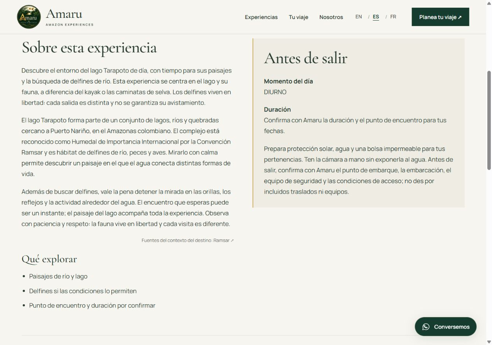

# Ampliación editorial de las ocho experiencias

Revisión del 11 de noviembre de 2026 a partir de la investigación entregada por el propietario y las fuentes públicas. Cambios posteriores a `ec5d868`, en la misma rama y PR #6; sin publicación.

Se amplían las 24 fichas EN/ES/FR con dos párrafos de contexto y recomendaciones propias de cada actividad. Se mantienen los bloques, encabezados, diseño, fuentes tipográficas, fotografías, contacto y toda la configuración SEO. La FAQ existente de las tres portadas incorpora preparación de llegada, consulta de transportes, conexión limitada y medios de pago.

## Evidencia y límites

| Experiencia | Contexto incorporado y fuente contrastada | Datos que siguen por confirmar con Amaru |
| --- | --- | --- |
| Lago Tarapoto | Lagos conectados por ríos/quebradas, humedal de importancia internacional y hábitat de fauna acuática y aves. [Registro oficial Ramsar 2336](https://rsis.ramsar.org/ris/2336). | Recorrido, duración, embarcación, equipo de seguridad, acceso y traslados. |
| Kaya | Paisaje fluvial y preparación de una actividad diurna de remo; variación de condiciones sin anunciar una ruta de bosque inundado. [Colombia Travel: Puerto Nariño](https://colombia.travel/es/puerto-narino). | Ruta, kayak, chaleco, acompañamiento, dificultad y condiciones para principiantes/niños. |
| Aves | Bosque y humedales como contexto regional de biodiversidad. [Ramsar](https://rsis.ramsar.org/ris/2336). Tarapoto no se anuncia como lugar confirmado de este tour. | Sitio de observación, guía especializado, equipos, especies documentadas y horarios concretos. |
| Cacao | Antecedente de la planta local anunciada en 2022 y procesos de fermentación, secado y transformación. [Cancillería, 10 octubre 2022](https://www.cancilleria.gov.co/sala-de-prensa/noticias/direccion-para-el-desarrollo-y-la-integracion-fronteriza-de-la-cancilleria-inauguro-en-puerto-narino-una-planta-para-el-procesamiento-de-cacao-amazonico). | No se confirma visita de Amaru a esa planta, alianza, demostración, degustación ni taller. |
| Caminata nocturna | Percepción del bosque tras oscurecer y observación cuidadosa. [Parques Nacionales: contexto regional de Amacayacu](https://www.parquesnacionales.gov.co/nuestros-parques/pnn-amacayacu/). | No se incorpora Amacayacu como destino de Amaru. Faltan trayecto, duración, equipo, seguridad y regreso. |
| Noche en selva | Preparación para un ambiente cálido/húmedo y diferencia entre caminata y pernocte. [Parques Nacionales](https://www.parquesnacionales.gov.co/nuestros-parques/pnn-amacayacu/) y [Colombia Travel](https://colombia.travel/es/puerto-narino). | Lugar y modalidad de descanso, transporte, baño/agua, alimentación, equipo y alternativa por mal tiempo. |
| Encuentros culturales | Presencia de pueblos ticuna, cocama y yagua, escucha y consentimiento. [Colombia Travel](https://colombia.travel/es/puerto-narino). | Identidad del anfitrión, consentimiento, lugar, contenido, idioma y cualquier aporte acordado. No se anuncia una comunidad, ceremonia o demostración concreta. |
| Selva y fauna | Diversidad regional de ambientes inundables y de tierra firme; mirada al ecosistema y observación respetuosa. [Parques Nacionales](https://www.parquesnacionales.gov.co/nuestros-parques/pnn-amacayacu/). | Sendero, terreno, distancia, duración, dificultad, accesibilidad y equipo. No se garantizan animales ni acceso a un parque. |

La FAQ de llegada y preparación utiliza [Colombia Travel](https://colombia.travel/es/puerto-narino) y contrasta la llegada fluvial con el [portal turístico de Puerto Nariño](https://puertonarinoamazonas.com/). No se publican tarifas, horas de salida, frecuencias ni tiempos tomados de esos portales. El visitante consulta la logística vigente y qué traslados figuran en su propuesta.

La noticia Ramsar enlazada en el documento y Canal Trece devolvieron 403 durante la consulta. La designación se verificó directamente en el registro Ramsar; la preparación del destino, en las fuentes institucionales accesibles. Los catálogos de otros operadores se trataron como referencias de preguntas, sin convertir sus servicios en prestaciones de Amaru ni enlazarlos como proveedores.

## Integración y revisión

- Contextos originales en `src/experience-editorial.mjs` y recomendaciones en el campo existente de `src/experience-pages.mjs`; renderizado estático dentro de los apartados actuales de las fichas. Las fuentes institucionales quedan visibles junto al contexto.
- Las descripciones de `Service` en JSON-LD mantienen la oferta existente: el nuevo contexto territorial no se añade como una inclusión del servicio. Títulos, metadescripciones, canonical, hreflang, Open Graph y sitemap permanecen iguales a `ec5d868`.
- Consejos formulados para preparar la visita o consultar al operador. No se han incorporado nuevas duraciones, precios, disponibilidad, equipos suministrados, alojamiento o condiciones comerciales.
- Revisar las 24 fichas y los cambios de FAQ en [PR #6](https://github.com/alejandr0qa/amaruamazon/pull/6). La [lista de validación del operador](pending-operator-information.md) sigue vigente.

Resultados: `npm ci`, `npm run build` y `npm run check` correctos. Las 27 páginas responden HTTP 200 y conservan exactamente metadatos, JSON-LD, encabezados y sitemap frente a `ec5d868`. Se comprobaron las 27 páginas a 390 y 1280 px (54 revisiones), sin desbordamientos, y la FAQ de preparación y el formulario en los tres idiomas, sin enviar mensajes. Los estilos y scripts funcionales permanecen idénticos.

Las mediciones de Lighthouse del documento de fase 3 corresponden al bloque técnico anterior; no se presentan como una nueva medición de este contenido.

