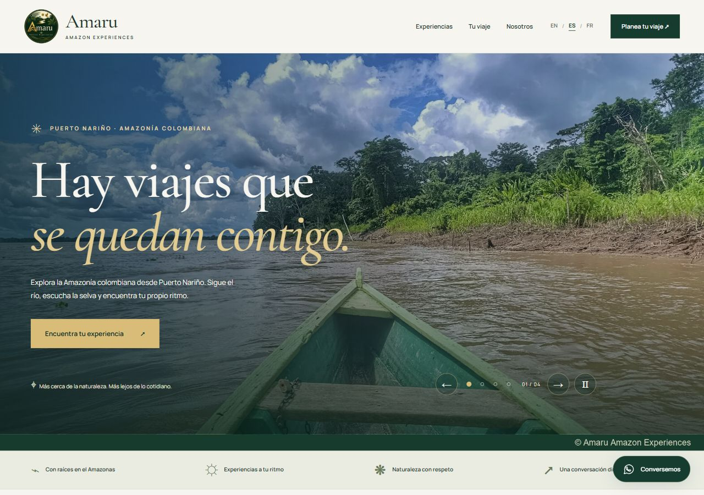
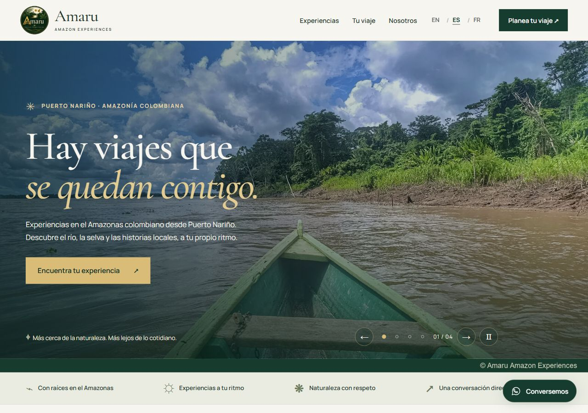
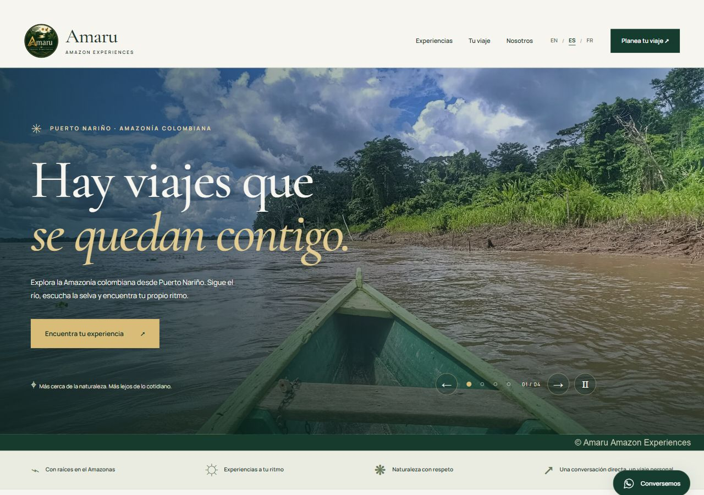
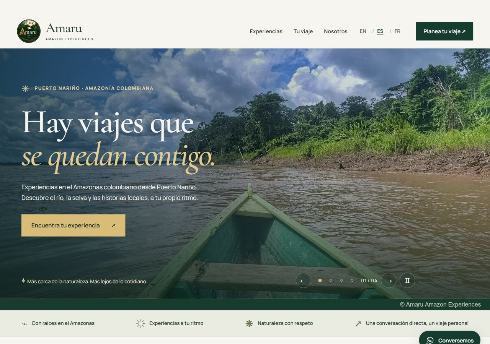
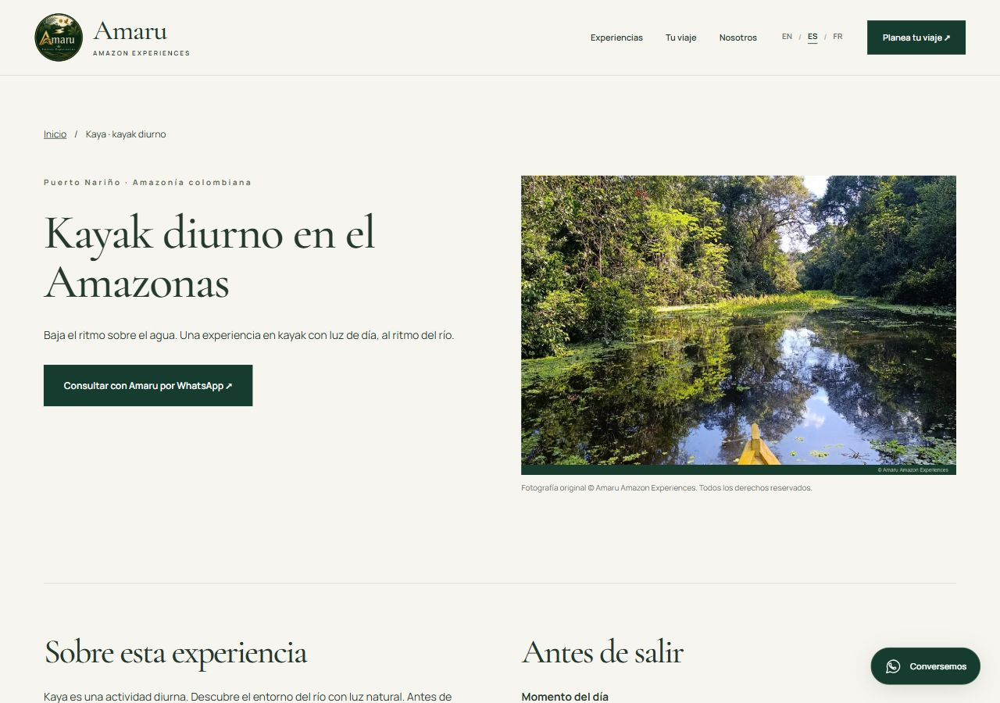
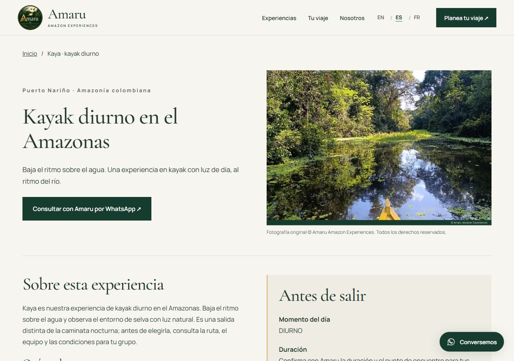
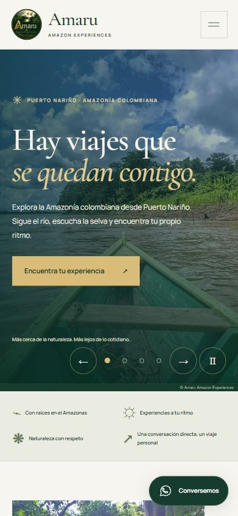
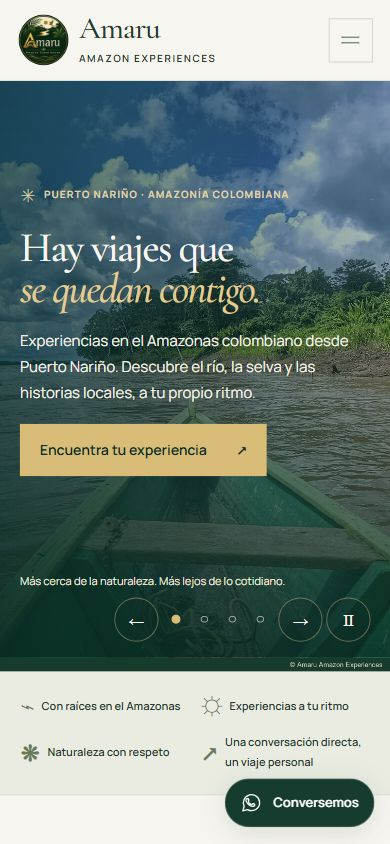
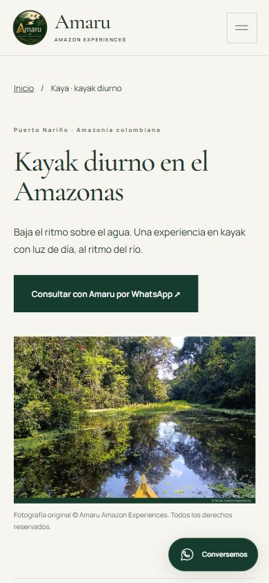
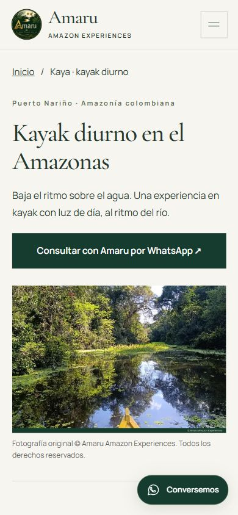

# Amaru: evolución integrada para revisión

11 de noviembre de 2026. Rama `codex/amaru-integrated-evolution`, sobre `main` en `ac1b5b1`. Sin publicación ni fusión.

Se conservan las 27 URL, ocho experiencias, tres itinerarios y tres idiomas. La paleta, fuentes, logotipo, fotografías propias, carrusel, galería y consultas por WhatsApp siguen presentes.

## Cambios

- Tipografía y contraste más legibles, menos separación innecesaria y tarjetas con mejor proporción entre foto, descripción y acciones. Menú adaptable también en tabletas; portada sin solapamientos en pantallas estrechas. Fichas con información práctica destacada y contacto visible. Favicon ICO de 16/32/48 px y acceso de inicio de 180 px derivados del logo existente.
- Presentación y descripciones específicas en EN/ES/FR, diferenciando las ocho experiencias. Kayak diurno; aves y cacao independientes. No se añadieron duraciones, inclusiones, testimonios ni condiciones sin confirmar.
- Títulos y metadescripciones localizados, alt que describen las fotografías y enlaces relacionados equilibrados. El idioma describe `WebPage` en JSON-LD; la entidad del operador mantiene un identificador común. Canonical, Open Graph, hreflang, sitemap y robots verificados.
- Copias de 480/800 px con `srcset`, conservando encuadre y franja de copyright. Los 22 derivados originales y los tres archivos previos de marca permanecen idénticos byte por byte. Pruebas compatibles con CRLF de Windows. Sin dependencias de producción nuevas.

## Validación

`npm ci`, `npm run build`, `npm run check`, sintaxis JavaScript y revisión de espacios: correctos. Prueba adicional con `robots.txt` en CRLF: correcta.

Las 27 páginas y 63 recursos locales respondieron 200. La lista del sitemap coincide exactamente con la anterior. Revisión de las 27 páginas a 320 y 1280 px; portadas en nueve anchos entre 320 y 1280 px, sin desbordamientos ni solapamientos entre CTA y controles.

En los tres idiomas se probaron filtros, fichas emergentes, itinerarios, galería, privacidad, carrusel y ambos formularios. Se comprobaron viajeros inválidos, fechas pasadas, actualización del mensaje, selección de experiencias y navegación entre idiomas. Los enlaces de WhatsApp se verificaron sin enviar mensajes.

Lighthouse 13.0.1, Chrome local, emulación móvil y preset de escritorio. Servidor Python sin compresión de transferencia; estas cifras no equivalen a PageSpeed del dominio ni a Core Web Vitals reales.

| Página | Rendimiento | Accesibilidad automática | Buenas prácticas | SEO |
| --- | ---: | ---: | ---: | ---: |
| Portada EN, móvil | 78 | 100 | 100 | 100 |
| Portada ES, móvil | 79 | 100 | 100 | 100 |
| Portada FR, móvil, mediana de tres pares | 76 | 100 | 100 | 100 |
| Kayak ES, móvil | 85 | 100 | 100 | 100 |
| Portada ES, escritorio | 97 | 100 | 100 | 100 |
| Kayak ES, escritorio | 100 | 100 | 100 | 100 |

En ES, la transferencia observada de portada bajó de 1.869.809 a 1.236.922 bytes (34%) y la ficha de kayak de 1.362.292 a 717.515 bytes (47%). El LCP móvil local de portada se mantuvo en 5,1 s; kayak pasó de 6,3 a 4,2 s. CLS: 0 en estas ejecuciones.

Las mediciones de CPU variaron: una ejecución FR dio 54. La serie posterior de tres pares dio 71/76/78 antes y 62/76/79 después, mediana 76 en ambos casos. No se declara una mejora de velocidad de portada ni cumplimiento de CWV. Tras aprobar y publicar, repetir PageSpeed en el dominio. Las puntuaciones automáticas no certifican accesibilidad completa.

[Evidencia resumida de pruebas y auditorías](phase-3/validation.json). Los informes completos de Lighthouse y registros de navegador quedan localmente en `.codex-preview/evolucion-integral/`.

## Vista previa y comparativas

Con el servidor local activo: <http://127.0.0.1:8077/es/>. Para iniciarlo desde la raíz del repositorio: `python -m http.server 8077 --bind 127.0.0.1`. Las rutas `/` y `/fr/` permiten revisar los otros idiomas.

Capturas antes/después con el mismo viewport: escritorio 1280 × 900; móvil 390 × 844.

| Vista | Antes | Después |
| --- | --- | --- |
| Portada, escritorio |  |  |
| Catálogo, escritorio |  |  |
| Ficha, escritorio |  |  |
| Portada, móvil |  |  |
| Ficha, móvil |  |  |

## Pendiente

El operador debe validar recorridos, duración, exigencia, equipo/inclusiones, logística, protocolos de seguridad, condiciones comerciales, identidad de anfitriones/guías y RNT/perfiles verificables. Confirmar recepción del correo corporativo. Los precios siguen por contacto directo. [Lista de datos y puntos de integración](../pending-operator-information.md).

Search Console registra 27 descubiertas según el propietario; falta confirmar indexadas y datos de rendimiento. [Procedimiento de seguimiento a 30/60/90 días](../google-search-console.md). DNS, Cloudflare, Pages, pagos y analítica quedan sin cambios.
